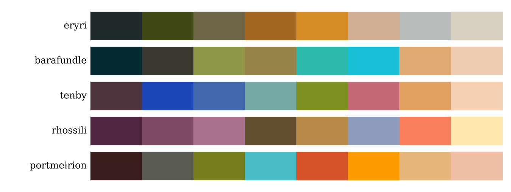

# hiraeth

*Hiraeth* (n., Welsh): a longing for home.

Colour palettes for R sampled from photographs of places in Wales, with ggplot2 scales and a helper to turn your own photographs into new palettes.



## Install

```r
# install.packages("devtools")
devtools::install_github("GREES27/hiraeth")
```

Or from the local folder:

```r
devtools::document("hiraeth")   # regenerates man/ pages from the roxygen comments
devtools::install("hiraeth")
```

## Palettes

| Palette | Place |
|---|---|
| `eryri` | Eryri (Snowdonia): slate, valley olive, bracken in low sun, alpenglow snow, still llyn |
| `barafundle` | Barafundle Bay: shaded cliffs, ruined stone arch, clifftop grass, turquoise water, sky, sandy path, beach |
| `tenby` | Dinbych-y-pysgod (Tenby): harbour stone, painted townhouses, Castle Hill, harbour teal, sand |
| `rhossili` | Rhossili, Gower, at sunset: heather, gorse, the Atlantic, orange sky, horizon gold (photo: Drew Buckley) |
| `portmeirion` | Portmeirion: copper beech, slate dome, turquoise cupola, terracotta, orange tower, pastel villas |

Every palette was sampled from a photograph of the place.

## Use

```r
library(hiraeth)
library(ggplot2)

display_all()                       # see every palette
hiraeth("tenby")                    # draw one palette
hiraeth("rhossili", 50, "continuous")

ggplot(mpg, aes(displ, hwy, colour = class)) +
  geom_point(size = 3) +
  scale_colour_hiraeth_d("eryri")

ggplot(faithfuld, aes(waiting, eruptions, fill = density)) +
  geom_raster() +
  scale_fill_hiraeth_c("rhossili")
```

## Make a palette from your own photo

```r
pal <- hiraeth_extract("photos/llyn_padarn.jpg", n = 7)
dput(as.character(pal))
```

Paste the result into `hiraeth_palettes` in `R/palettes.R`, add a line to its documentation, and reinstall.
