# hiraeth

*Hiraeth* (n., Welsh): a longing for home.

Colour palettes for R sampled from photographs of places in Wales, with ggplot2 scales and a helper to turn your own photographs into new palettes.


## Install

```r
# install.packages("devtools")
devtools::install_github("GREES27/hiraeth")
```

Or from the local folder:

```r
devtools::document("hiraeth")   # regenerates man/ pages from the roxygen comments
devtools::install("hiraeth")
```

## Palettes

| Palette | Place |
|---|---|
| `eryri` | Eryri (Snowdonia): slate, valley olive, bracken in low sun, alpenglow snow, still llyn |
| `barafundle` | Barafundle Bay: shaded cliffs, ruined stone arch, clifftop grass, turquoise water, sky, sandy path, beach |
| `tenby` | Dinbych-y-pysgod (Tenby): harbour stone, painted townhouses, Castle Hill, harbour teal, sand |
| `rhossili` | Rhossili, Gower, at sunset: heather, gorse, the Atlantic, orange sky, horizon gold (photo: Drew Buckley) |
| `portmeirion` | Portmeirion: copper beech, slate dome, turquoise cupola, terracotta, orange tower, pastel villas |

Every palette was sampled from a photograph of the place.
## The places

## The places

## The places

<table>
  <tr>
    <td width="260">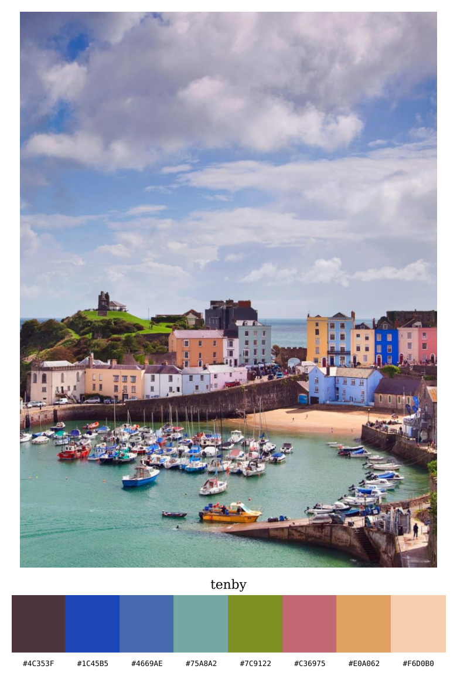</td>
    <td>
      <h3>tenby</h3>
      <p><b>Dinbych-y-pysgod, Pembrokeshire.</b> A walled seaside town whose
      harbour is lined with brightly painted Georgian houses, looking out
      over Castle Hill and the boats at low tide.</p>
      <p><code>hiraeth("tenby")</code></p>
    </td>
  </tr>
  <tr>
    <td width="260">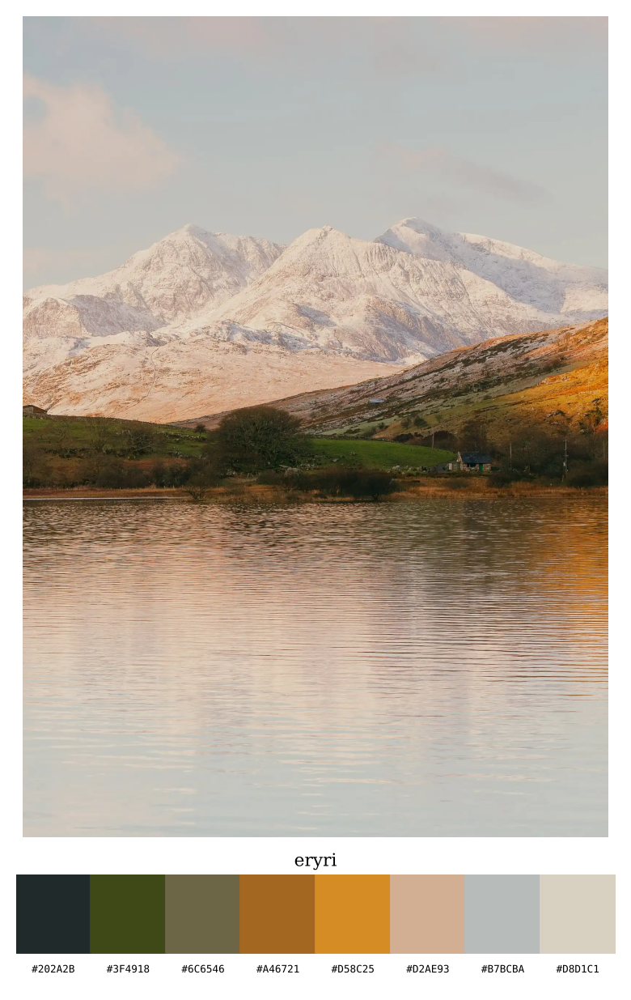</td>
    <td>
      <h3>eryri</h3>
      <p><b>Eryri (Snowdonia), Gwynedd.</b> The snow-covered Yr Wyddfa
      massif, the highest ground in Wales, catching the last light across
      a still lake, with bracken glowing on the lower slopes.</p>
      <p><code>hiraeth("eryri")</code></p>
    </td>
  </tr>
  <tr>
    <td width="260">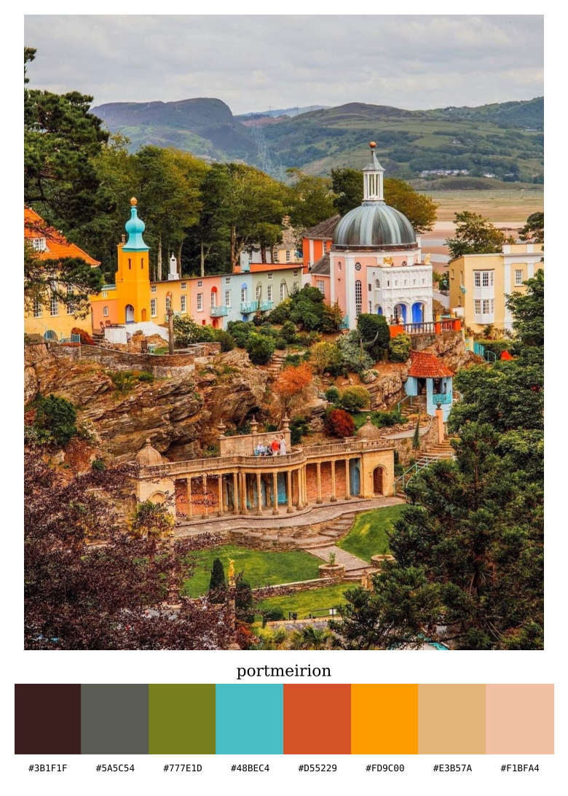</td>
    <td>
      <h3>portmeirion</h3>
      <p><b>Portmeirion, Gwynedd.</b> The Italianate village built by Clough
      Williams-Ellis on the Dwyryd estuary: turquoise cupolas, terracotta
      roofs and pastel villas among the trees.</p>
      <p><code>hiraeth("portmeirion")</code></p>
    </td>
  </tr>
  <tr>
    <td width="260">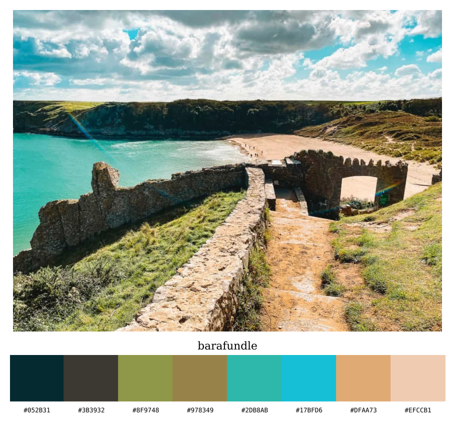</td>
    <td>
      <h3>barafundle</h3>
      <p><b>Barafundle Bay, Pembrokeshire.</b> A sheltered cove on the
      Stackpole estate, reached only on foot through an old stone archway,
      with turquoise water, pale sand and wooded cliffs.</p>
      <p><code>hiraeth("barafundle")</code></p>
    </td>
  </tr>
  <tr>
    <td width="260">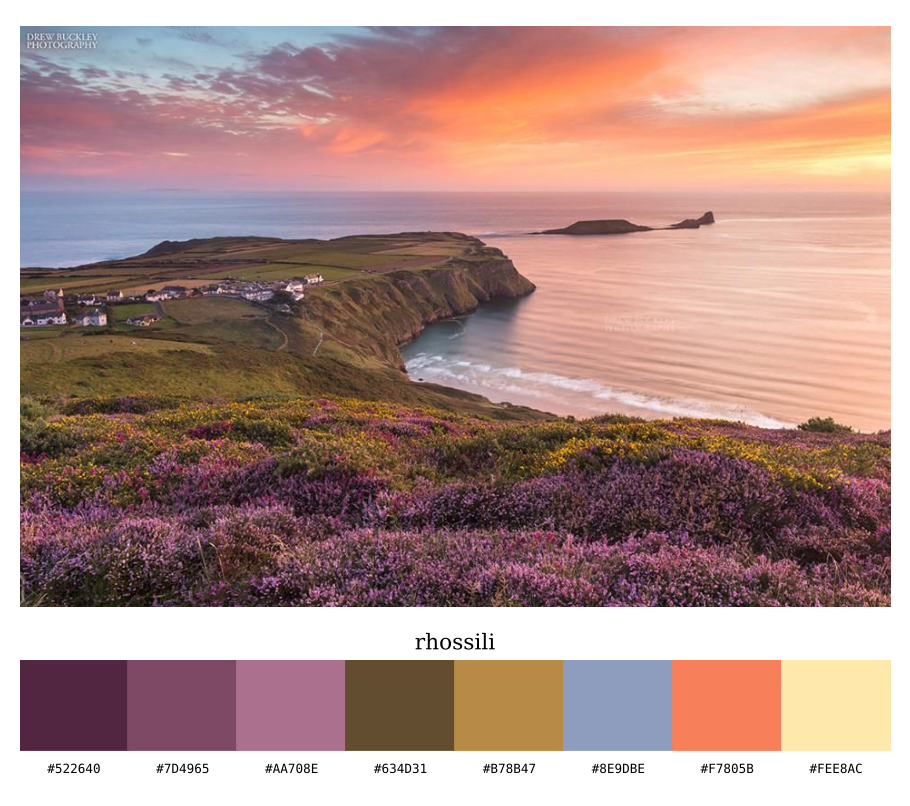</td>
    <td>
      <h3>rhossili</h3>
      <p><b>Rhossili, Gower.</b> Heather and gorse on the clifftops at
      sunset, looking out over the bay to the tidal island of Worms Head.
      Photo: Drew Buckley.</p>
      <p><code>hiraeth("rhossili")</code></p>
    </td>
  </tr>
</table>

## Use
   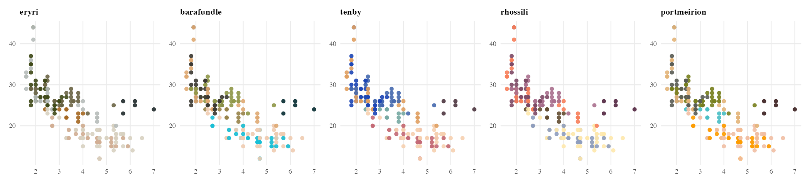

   <details><summary>See each palette in action</summary>

   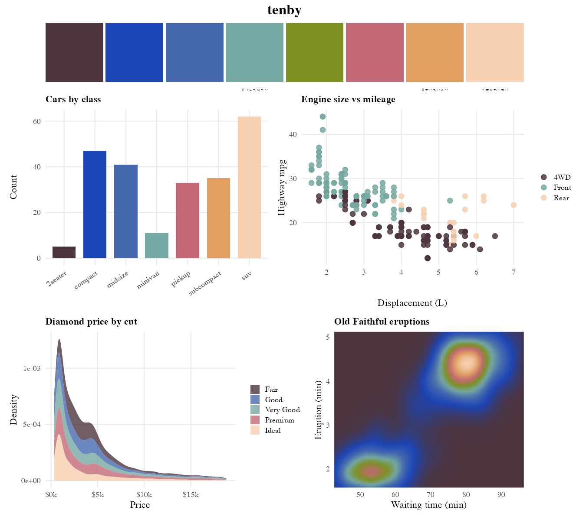
   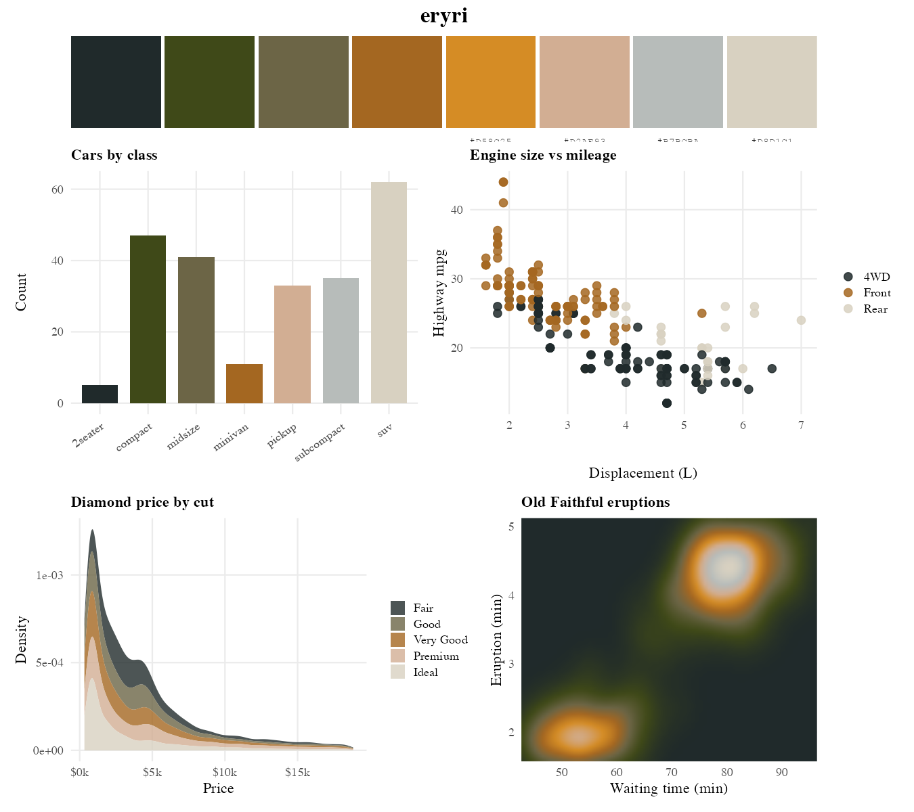
   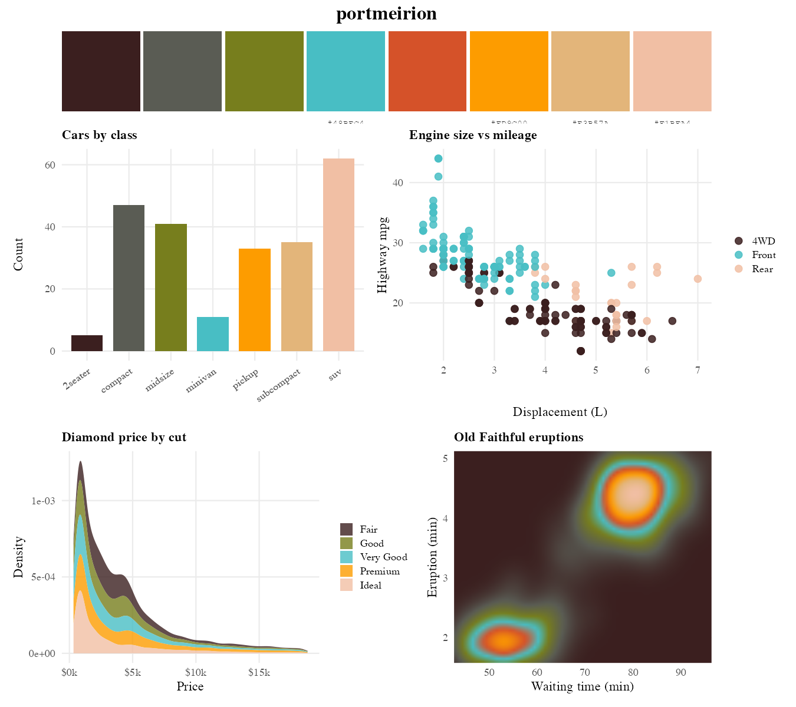
   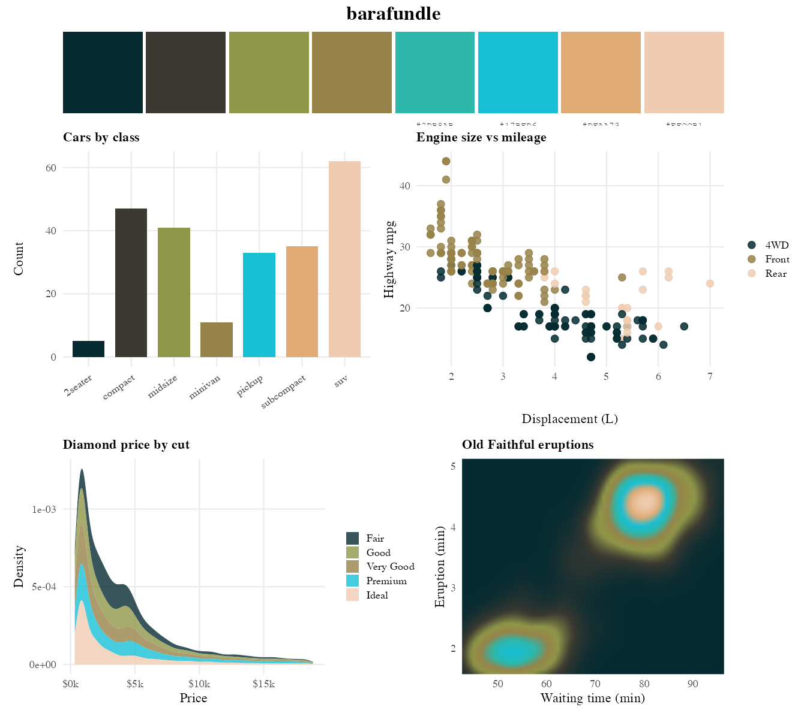
   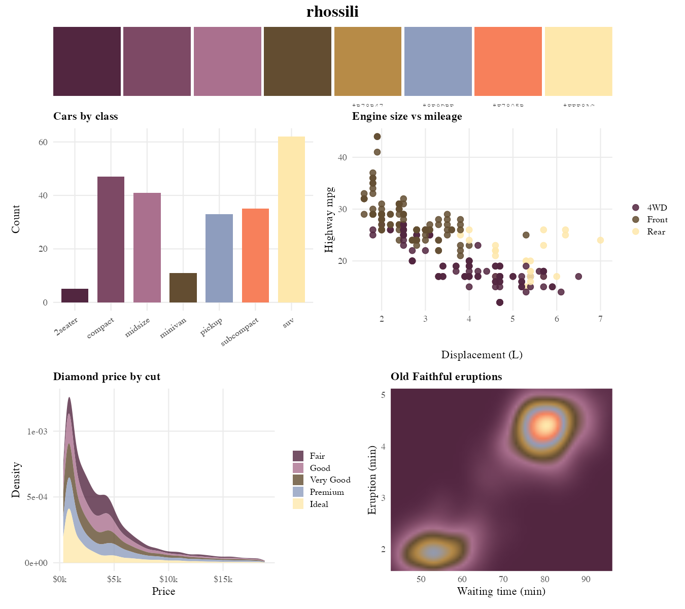

   </details>
   
```r
library(hiraeth)
library(ggplot2)

display_all()                       # see every palette
hiraeth("tenby")                    # draw one palette
hiraeth("rhossili", 50, "continuous")

ggplot(mpg, aes(displ, hwy, colour = class)) +
  geom_point(size = 3) +
  scale_colour_hiraeth_d("eryri")

ggplot(faithfuld, aes(waiting, eruptions, fill = density)) +
  geom_raster() +
  scale_fill_hiraeth_c("rhossili")
```

